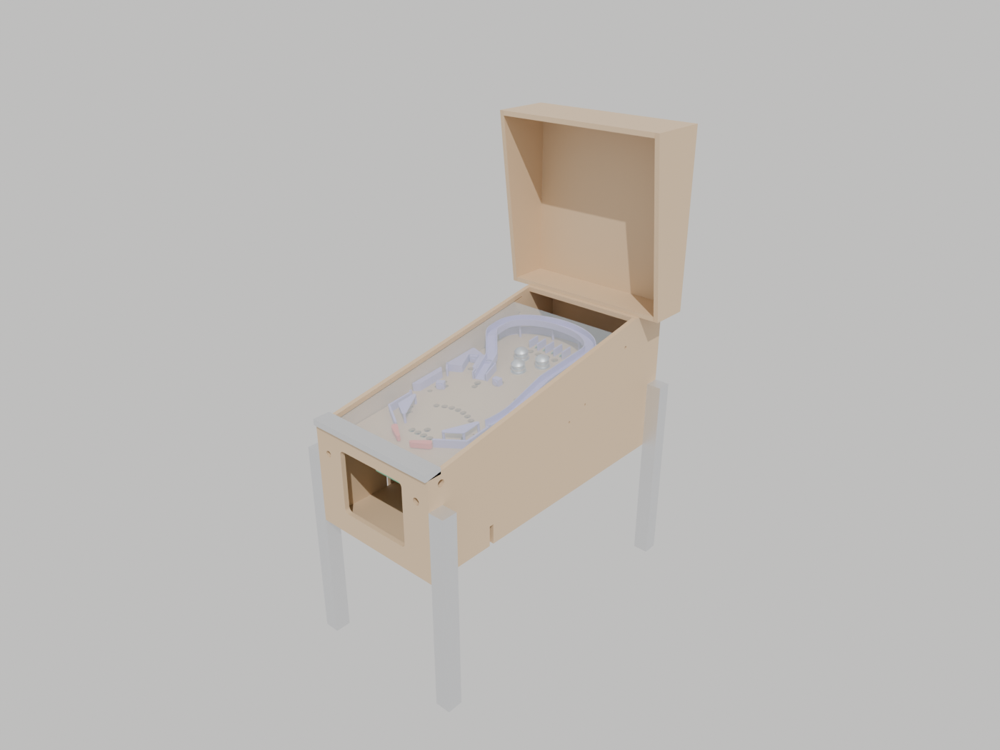

# Construction de la réplique : CAO, plans cotés, caisse

Les plans sont **générés** à partir de la géométrie du jeu : ce qui se joue dans le navigateur et ce qui se perce dans le bois sont les mêmes cotes.

- **Plans cotés (PDF A3, 12 planches)** : [plans/plans_fanny_pinball.pdf](plans/plans_fanny_pinball.pdf), avec un aperçu PNG de chaque planche dans `docs/plans/`.
- **Modèle 3D** : `cao/sortie/assemblage.FCStd` (FreeCAD) et `assemblage.step`.
- **Pièces** : `cao/sortie/pieces/*.step`, plus un `.stl` pour chaque pièce à imprimer, dont les tronçons de rampe.
- **Panneaux de caisse** : `cao/sortie/caisse/*.step`.
- **Rendus de contrôle** : [plans/rendus/](plans/rendus/).



## Chaîne de production

```
js/table.js ──(cao/exporter_geometrie.py, Chrome sans écran)──► cao/geometrie.json
cao/cotes.py  (cotes de référence + leur source)                       │
                                                                        ▼
                                cao/modele.py  (modèle 2D commun : pièces, perçages, rampe, panneaux)
                                   │                                    │
          freecadcmd cao/construire.py                         python3 cao/plans.py
          (solides, STEP, STL, assemblage)                     (PDF coté, nomenclature, débit)
                                   │
          blender -b -P cao/rendu_blender.py  (rendus de contrôle)
```

Pour tout régénérer après une modification de la table :

```
python3 cao/exporter_geometrie.py
freecadcmd cao/construire.py        # ~5 min
python3 cao/plans.py
python3 outils/cao_web.py           # pièces pour la vue 3D du jeu (assets/cao/pieces.glb)
python3 outils/pwa.py               # cache de l'application installable
```

## Contenu des planches

| N° | Planche |
|---|---|
| 01 | Plateau, vue de dessus, au 1:3. Tous les perçages sont numérotés : fixations, inserts de lampes, mécanismes, passe-fils. |
| 02–03 | Tableau des perçages : X/Y depuis le coin avant gauche, forme, Ø ou oblong et angle, source de la cote. |
| 04 | Dessous du plateau : encombrement des mécanismes achetés et des détecteurs imprimés. |
| 05 | Coupes cotées des détecteurs (rollover à fil, cible fixe, Cercle, couloir de lancement et bac, barrière IR de rampe, KW11). |
| 06 | Pièces imprimées, vues de dessus cotées, avec les coordonnées de chaque point de fixation. |
| 07 | Rampe : profil en long, poteaux (hauteur, position), découpe en tronçons de 200 mm. |
| 08 | Caisse : flanc, façade, arrière, fond, dessus arrière. |
| 09 | Fronton (backbox). |
| 10 | Assemblage : coupe longitudinale cotée (hauteurs au sol) et vues 3D. |
| 11 | Nomenclature, quincaillerie, débit indicatif des panneaux de 2500 × 1250. |

## Principes de fixation

- **Pièces imprimées (PETG).** Elles sont tenues **par dessous**.
  - Une vis M3 × 20 traverse le plateau dans un trou Ø 3,5.
  - Elle se serre dans un insert laiton M3 posé à chaud dans la pièce (trou Ø 4 × 6).
  - Les fixations sont espacées de 90 mm au plus.
  - Rien ne dépasse côté jeu.
- **Mécanismes achetés.** Flippers, bumpers, lance-pierres et banque de cibles tombantes se vissent sous le plateau avec des vis à bois 3,5 × 13.
  - La platine réelle sert de gabarit.
  - Les zones orange de la planche 04 donnent l'encombrement prévu.
- **Plateau.** Contreplaqué bouleau de 12 mm, posé sur deux tasseaux 20 × 30 vissés-collés aux flancs, pente 6,5°.

## Détection du passage des billes

Tous les contacts sont des micro-rupteurs **KW11-3Z**, câblés NO vers la masse, avec l'entrée du Mega en INPUT_PULLUP :

- **Couloirs T-O-U-R.** Rollover à fil : corde à piano Ø 1,5 cintrée en U, qui dépasse de 6 mm par une lumière 36 × 4 et appuie sur le levier du KW11.
- **Cibles fixes POINTER, TIRER et cochonnet.** Une face pivote sur un axe Ø 3 et pousse le KW11 logé dans le boîtier imprimé.
- **Cibles rondes du mur gauche.** Le KW11 est logé dans le mur, et les fils passent par un trou Ø 8.
- **Le Cercle.** Une cuvette imprimée (Ø intérieur 32, profondeur 18) porte le KW11 sous son fond et un doigt d'éjection mû par une bobine.
- **Couloir de lancement.** Un KW11 sous la bille au repos détecte la bille. Le bac à billes a un KW11 par place.
- **Sortie de rampe.** Une barrière infrarouge (LED 940 nm et phototransistor) est placée à 12 mm du fond.
- **Cibles tombantes et lance-pierres.** Les contacts sont ceux des mécanismes achetés.

## Cotes relevées sur les gabarits Pinball Makers

Les gabarits de perçage STL de [Pinball Makers](https://pinballmakers.com/wiki/index.php?title=Files_Section) ont été mesurés dans FreeCAD (source « PM » dans `cao/cotes.py`) :

| Mécanisme | Mesure du gabarit | Ancienne hypothèse |
|---|---|---|
| Bumper : trou central | Ø 16,3 + 2 encoches de clavette à 45° (rayon 14) → Forstner 17 + lime | Ø 17 |
| Bumper : tiges de l'anneau | 2 × Ø 9, entraxe **35,0** | Ø 8, entraxe 44,5 |
| Bumper : vis de la base | 3 avant-trous Ø 3 (± 25,5 ; 10,7) et (0 ; 28,7) depuis le centre, empreinte Ø 69 | — |
| Lance-pierre 500-5849 : bras | oblong **25,1 × 12,7**, presque perpendiculaire à la face | 40 × 10 |
| Lance-pierre : contacts à lames | 4 passages Ø 12,7 | 2 passe-fils Ø 8 |
| Lance-pierre : poteaux | Ø 6,1, distants de 100,9 | — |

Le gabarit du lance-pierre est posé sur les deux poteaux de la face du jeu, centré au milieu. La face du jeu mesure 101 mm entre les poteaux, comme le mécanisme Williams 500-5849 (raccourcie le 20/11, angle de face conservé).

Les plans DWG du même site ont été convertis en DXF avec LibreDWG 0.14, compilé en local car il n'existe pas de paquet Debian 13. Le relevé est fait par `assets/brut/analyse_dxf.py` (source « DWG » dans `cao/cotes.py`). Les plans sont en pouces, sauf la banque de 5, qui est en mm.

| Pièce | Cote relevée | Usage |
|---|---|---|
| Flipper A-15205 : bague | trou **Ø 1/2" (12,7)** traversant, avant-trou Ø 1/8" | perçage du plateau |
| Flipper A-15205 : platine | **5,06 × 3,84" (128,6 × 97,6)**, centre à 38,9 mm vers la pointe et 9,9 mm vers l'avant de l'axe ; 8 vis | encombrement sous le plateau |
| Banque de 5 cibles tombantes | pas **31,75 mm (1-1/4")**, cible **22,5 × 8,1**, platine **171,5 × 89** | pas des cibles du jeu passé de 28 à 31,75 mm |
| Bumper Williams/Bally | base Ø 3" (76,2), tiges Ø 3/8" à ± 0,6875" (entraxe 34,9), 3 vis Ø 3/32" | confirme les cotes « PM » |
| Lance-pierre 500-5849 | 2 trous Ø 1/2" à 2,125" (54 mm), lumière du bras 0,5 × 0,62" | confirme le gabarit « PM » |
| Rollover A-12688 | fente 3/16 × 1-3/8" (4,8 × 34,9), 2 vis | pour des contacts de couloir à fil |
| Cible fixe B-12001-4 | face 1-1/16" (27), fente 3/16", 2 vis à 3/8" d'entraxe | cible achetable à la place d'une cible imprimée |
| Trough 4 billes 500-6119-14 | logement 8,86 × 1,5" (225 × 38) | sous le plateau |

Les encombrements des bobines de bumper et de lance-pierre ne figurent pas sur ces gabarits et restent à confirmer (HYP).

## Cotes encore à confirmer (en orange sur les plans)

Il faut les relever sur la pièce achetée **avant de percer** :

- Ø de la bague de flipper.
- Lumières de la banque de cibles tombantes.
- Encombrements sous le plateau.
- Cotes du KW11.
- Pieds.

## La caisse

### Peut-on l'acheter nue ?

Recherche du 20 novembre 2026 :

| Offre | Ce que c'est | Prix | Remarque |
|---|---|---|---|
| [American Pinball — blank cabinet with head](https://store.american-pinball.com/products/blank-pinball-cabinet-with-head) | Caisse et fronton neufs, nus | 699,80 $ | États-Unis : port et douane en plus |
| [Let's Play Pinball](http://www.letsplaypinball.com/cabinets.html) | Caisses bois brut aux cotes Williams/Bally | 500–750 $ | États-Unis |
| [EZPinball](https://pinside.com/pinball/forum/topic/reproduction-classic-stern-cabinets-now-available) | Reproductions de caisses Stern, en kit plat | 795 $ | États-Unis |
| [pinballshop.nl](https://www.pinballshop.nl/virtual-pinball/diy-virtual-pinball-cabinets/?sl=en) | Caisses « DIY » au format standard | variable | Europe, souvent prévues pour flipper virtuel (écran à la place du plateau) |
| [Knockout Arcades](https://knockoutarcades.com/32-pinball-arcade-cabinet-kit-black-flat-pack) | Kit plat 32" | — | Royaume-Uni, flipper virtuel |
| [Tukkari](https://www.tukkari.eu/p/widebody-virtual-pinball-cabinet-vpin-fully-assembled) | Caisse widebody assemblée | — | Europe, flipper virtuel |

**Conclusion.**
- On n'a pas trouvé en Europe de châssis nu complet pour flipper **réel** : les offres européennes visent le flipper virtuel.
- Les caisses américaines conviennent, mais les frais de port d'un meuble de 1,3 m et la douane doublent à peu près le prix.
- **On construit donc la caisse** aux cotes de la caisse Williams WPC « standard body ». Les plans viennent de [Pinball Makers](https://pinballmakers.com/wiki/index.php?title=Files_Section) (Wpc-cabinet-2/3, Wpc-backbox-1).
- Une caisse « virtuelle » du commerce peut servir si elle reprend ces cotes, mais il faut vérifier qu'elle accepte un plateau de 514 mm et ses mécanismes sous le plateau.

### Matériaux

- **Caisse et fronton.** Contreplaqué 19 mm, bouleau ou peuplier : 2 panneaux de 2500 × 1250 (débit sur la planche 11).
- **Fond du fronton.** Contreplaqué 6 mm.
- **Plateau.** Contreplaqué bouleau 12 mm.
- **Assemblage.**
  - Feuillures 10 × 10, colle vinylique et vis 4 × 50.
  - Tasseaux d'angle 20 × 20.
  - Tasseaux 20 × 30 sous le plateau.
- **Achats.**
  - 4 pieds de flipper 32" avec platines, boulons 3/8"-16 et vérins.
  - Barre de verrouillage, charnière et verrous de fronton.
  - Verre trempé 4 mm.
  - Boutons d'arcade 28 mm (flippers, LANCER) et 25 mm (START).
  - Ventilateur 80 mm.

Le plateau est plus étroit que l'intérieur de la caisse : 514 mm pour 520,8 mm. Il reste donc 3,4 mm de jeu de chaque côté.
